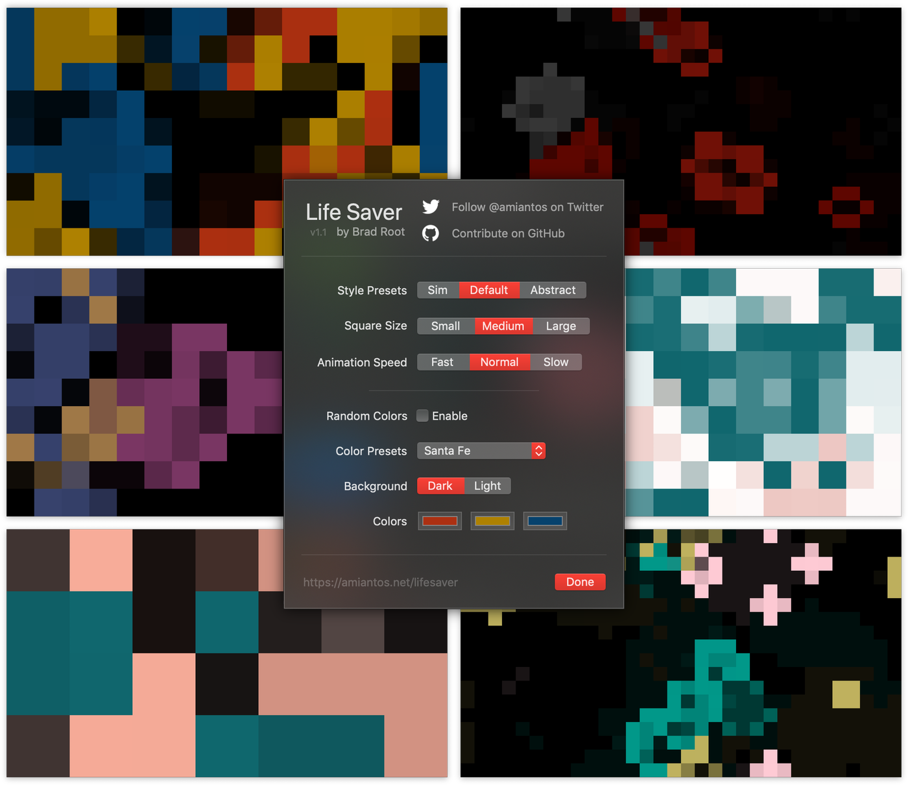
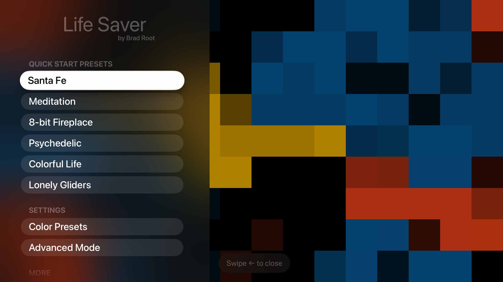
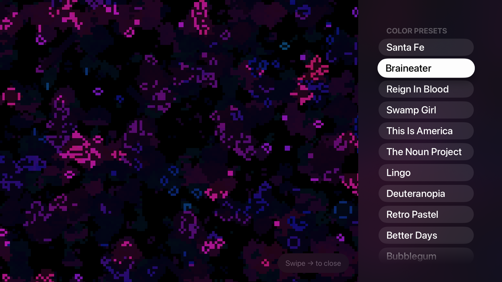

# Life Saver

Life Saver is an abstract, artistic implementation of [Conway's Game of Life](https://en.wikipedia.org/wiki/Conway%27s_Game_of_Life) built with SpriteKit. With a variety of settings and color schemes, Life Saver should satisfy designers and geeks alike. Ships as a macOS Tahoe screensaver (delivered as an app + ExtensionKit screensaver extension) and an Apple TV app.

## 🖥&nbsp;&nbsp;Screensaver

📼  [Watch a YouTube video to see it in action](https://www.youtube.com/watch?v=N4nCFUVThgg).

Life Saver for macOS Tahoe ships as `Life Saver.app`, which registers an embedded ExtensionKit screensaver extension. Launch the app once, then pick Life Saver in **System Settings → Screen Saver**. Building from source is the current distribution path — see "To Install from Source" below.

## 📺&nbsp;&nbsp;Apple TV

### 👉 [Get Life Saver TV on the App Store](https://apps.apple.com/us/app/life-saver-tv/id1470667717)

## Community

For devlogs, discussion, and support, visit the [Life Saver forum](https://discuss.bradroot.me/tags/c/projects/13/life-saver/7).

## To Install from Source

1. `git clone https://github.com/amiantos/lifesaver.git`
2. Open `Life Saver.xcodeproj`
3. Pick a target and run!

